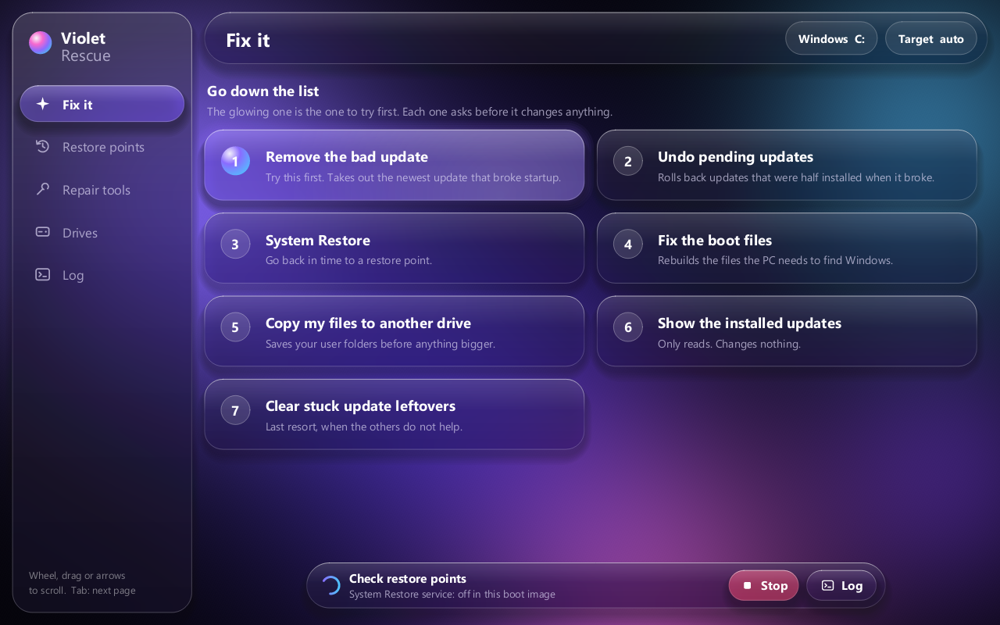

# Violet Rescue

A boot-time repair app for Windows 10 and 11 PCs that won't start. Boot it from a USB stick and fix
the PC with big buttons: remove the update that broke startup, undo half-installed updates, rebuild the
boot files, put a saved copy of the registry back, copy your files off, and run offline SFC, CHKDSK and DISM.



> **Early release (0.1).** Violet Rescue has been booted and used on a real broken PC, and some of it
> helped. It has not been tested across many machines, and repairing a PC that won't start is risky
> whatever tool you use. **Copy your files off first** (button 5 on the Fix it page), and read
> [what is not proven yet](#not-proven-yet-and-things-to-know) before you rely on it.

**Guides and slides:** <https://violinet-tech.github.io/violet-rescue/>

## How it works

- **The window**: `gui/VioletRescueUI.exe`, a native Rust app (`ui-rs/`). Glass menu on the left, big
  buttons, inertial scrolling, works with a mouse, a touch screen or the keyboard. It draws everything
  on the CPU, so it runs inside the Windows Recovery Environment, which has no graphics driver.
  Commands that change anything ask first.
- **The classic window**: `gui/RescueGUI.ps1`, the PowerShell version. It still has the pages the new
  window doesn't yet (fresh Windows, moving files, NVIDIA drivers, cable link, agent help).
- **CLI backend**: `cli/rescue.ps1 <command> -Drive C [-Target E] [-Option ...]`. Every repair is a command,
  and each one works on the offline Windows install. Both windows run these commands.
- **Launcher**: `Rescue.cmd` opens the glass window, then the classic one if that can't start, then the CLI.
  With no PowerShell (a plain setup USB) it falls back to the plain `.cmd` fixes.
- **Boot media**: `build/build-media.cmd` builds a WinRE/WinPE image with PowerShell, .NET and the DISM cmdlets,
  and starts the app on boot. It outputs an ISO or a USB.
- **Always-there recovery**: `build/install-boot-entry.cmd` copies the image to a partition the boot manager can
  read and adds a boot-menu entry. It also makes the image the recovery target, so two failed boots open Violet Rescue
  instead of looping.
- **Windows ADK**: `build/get-adk.cmd` installs Microsoft's Assessment and Deployment Kit plus the WinPE add-on through winget.
  The build needs them. They're downloaded, not bundled, because Microsoft's licence doesn't allow redistributing them.

## Commands (one button each)

| Button | Command | Does |
|---|---|---|
| List drives | `drives` | Every drive, sizes, which hold Windows |
| Scan updates | `updates` | Installed updates newest first, known-bad ones flagged from `db/known-bad.json` |
| Remove update | `remove-update` | Removes one update (newest by default), with a dism.exe fallback |
| Undo pending updates | `revert-pending` | `/revertpendingactions` and renames `pending.xml` |
| Rollback machine | `rollback` | Removes the updates **and** drivers installed since a date |
| System Restore | `restore` | Opens `rstrui /offline` (only in media built from winre.wim) |
| SFC scan | `sfc` | Offline `sfc /scannow` |
| Check disk | `chkdsk` | `chkdsk /f /x` |
| DISM repair | `restorehealth` | Finds install media, matches the edition index and runs `/restorehealth` |
| Fix boot files | `bootfix` | Finds the EFI partition on the Windows disk. Formats it FAT32 only if it isn't already, after asking. Then backs up the old BCD and runs `bcdboot` |
| List drivers / Remove driver | `drivers`, `remove-driver` | Lists and removes third-party drivers by `oemNN.inf` or Provider,Class |
| Remove NVIDIA display | `remove-nvidia` | Removes NVIDIA display drivers (`all` removes every NVIDIA driver) |
| Install drivers | `add-drivers` | Installs `drivers/nvidia`, `realtek`, `amd-chipset` or any folder |
| Block / Allow Windows drivers | `block-driver-updates` | Offline policy `ExcludeWUDriversInQualityUpdate` + `SearchOrderConfig` |
| Malware startup scan | `malware-scan` | Lists Run keys (machine and every user) and services, and flags unsigned files, files in user-writable folders and script tricks |
| Disable startup item | `disable-startup` | Moves the entry to a `RescueDisabled` key, so it can be put back |
| Backup files | `backup` | Copies the Users folders (or another folder) to any other drive with robocopy, and writes a log |
| Start network | `net-up` | Loads the Realtek drivers and starts wired networking |
| Update database | `update-db` | Downloads a new `known-bad.json` from the URL in `db/source.json` |

## Restore points (tab "Restore points")

The point of this tab is that a restore never ends in "System Restore did not complete". It has three layers, and
each one still works if the one before it fails:

1. **System Restore, repaired and proven (in Windows).** **Fix System Restore** (`rp-fix`) starts the shadow copy
   services, removes policies that switch it off, switches it on, gives it 10% of the drive, restarts failing
   shadow copy writers, and turns RegBack back on (Windows stopped writing that registry backup in 2018). It then
   makes a restore point and **opens it to check that the registry is inside**, so a damaged one shows up now
   instead of on the day you need it. **Start fresh** (`rp-reset`) deletes damaged restore points and does the same.
   **Automatic daily** (`rp-auto`) makes a restore point and a Violet snapshot every day and after each start, as a
   SYSTEM task that runs a copy of the app on the Windows drive.
2. **Safer System Restore (USB).** `restore-safe` first saves a snapshot, then runs check disk, which repairs the
   file damage behind 0x800700fe. It moves `Program Files\WindowsApps` aside, the folder restores most often fail
   on (0x80070091, 0x800700fe), and only then opens System Restore. Afterwards it puts the folder back with its
   permissions.
3. **Without System Restore (USB).**
   - `rp-shadow-restore` copies the system registry straight out of a chosen restore point and puts it in place,
     the part System Restore fails on.
   - `snap-restore` puts back a **Violet snapshot**: the whole registry (SYSTEM, SOFTWARE, SAM, SECURITY, DEFAULT,
     COMPONENTS and each user's NTUSER.DAT/UsrClass.dat), kept in `<drive>:\VioletRescue\Snapshots`. It needs no
     shadow copy service at all. Old transaction logs are cleared so they can't be replayed onto the restored hives.

Every put-back first saves the current registry as `before-restore_<date>`, so it can be undone with `snap-restore`.

Limits:
- A snapshot is the registry only. Programs and drivers installed since then stay on disk but are forgotten, and
  passwords go back to what they were then. If updates were installed since, remove them first (`rollback`).
- Snapshots sit on the same drive, so they don't help if the drive itself fails; that is what **Backup files** is for.
- WinPE built from `winpe` has no shadow copy service. There, `rp-shadow-restore` and `restore-safe` say so, and
  `snap-restore` still works.

## Fresh Windows and moving files (tab "New Windows + files")

| Button | Command | Does |
|---|---|---|
| Make fresh Windows | `new-windows` | Shrinks the Windows drive by the GB you choose, or uses an erased target partition. It then applies the matching edition from the install USB and adds the new Windows to the boot menu first, with the old one kept |
| Load folder list | `migrate-list` | Every folder on the old drive: each user's Desktop, Documents, Downloads, Pictures, Music, Videos, AppData (Roaming, Local, LocalLow) and anything else in the profile, plus top-level folders (Program Files, ProgramData, Games...). Sizes are shown, and you tick what you want |
| Pack ticked into zip | `migrate-pack` | Packs one compressed zip (Zip64, so no size limit) with a manifest into `<target>\VioletMigrate\<date>\`. Locked or unreadable files are listed in `skipped.txt`. If the target is the new Windows, it also copies the app there and puts **Restore my files** on its desktop |
| Restore my files | `migrate-restore` | In the new Windows: unzips straight into place. User folders go to the signed-in user, and other old accounts go to `Old users\<name>`. Existing files are never overwritten |

Program Files, ProgramData and AppData are copied as files. Programs still need reinstalling to run, and the list says so.

## NVIDIA drivers (tab "NVIDIA drivers")

**Load card list** pulls NVIDIA's own list of every card, current and legacy (about 1,000, each shown with its series so
desktop and notebook cards don't get mixed up), and preselects the detected card. Pick **Game Ready**, **Studio** or
**All types**, then either **Download newest** or **List all versions**. The second shows every driver NVIDIA still
offers for that card, newest first; pick one and press **Download selected**.

Legacy cards: when there's no current Windows 11 driver, it falls back to the Windows 10 driver, then the legacy
Standard (non-DCH) driver, and marks which route it used. Checked on 2026-11-07: a GTX 780 on Windows 11 lists 15
legacy drivers (475.14 security update down to 471.41). A GTX 480 has no Windows 10 DCH driver, so it needs the
Standard route. That route wasn't confirmed, because NVIDIA timed out during the check.

Both ask NVIDIA's driver lookup (the one nvidia.com/drivers uses) for the newest one and downloads it
from `us.download.nvidia.com`. I checked this on 2026-11-07: an RTX 3060 on Windows 11 returned Game Ready 621.14 and Studio 621.14.
That lookup is NVIDIA's website service, not a published API, so it can change. Inside Windows the installer starts after asking.
On the rescue USB the driver is only saved, because the installer runs from Windows.

## Cable link (tab "Cable link")

Plug an Ethernet cable straight into a working PC and run `helper\RescueHelper.ps1` there as administrator. You can
run it from this USB on that PC. It shows a 6-digit code. On the broken PC, **Check cable** says whether the cable goes to
another computer and finds the helper, and **Link** with the code connects them. From the helper's terminal menu you can:

1. Send files or folders to the broken PC (they land in `Received`)
2. Get files or folders from the broken PC
3. Run any rescue command on it (only rescue commands, not arbitrary programs)
4. Share its internet over the cable (Windows Internet Connection Sharing; the link reconnects by itself)
5. Stop sharing
6. Agent help

Wire format: `cli/modules/wire.ps1`. It uses a UDP beacon on 47830, the link on TCP 47831 and the agent bridge on 127.0.0.1:47832.
The helper opens a firewall rule only while it runs. Five wrong codes stop it.

## Agent help (tab "Agent help")

Two VIOLINET agents, **Codey** (coding) and **Warden** (machine watch), run in **Claude Code**. The brief is
`agent/RESCUE-AGENT.md`: diagnose first, look-only commands
run freely, and anything that changes the PC needs the user's yes in chat. `support-bundle` collects the drive, update,
driver and startup lists, the CBS log tail, event logs, minidump names and SrtTrail.
- **From the rescue USB**: Claude Code can't run in WinPE. The helper PC runs it (menu 6). It pulls the bundle over the
  cable and reaches the broken PC through `helper/send.ps1`.
- **In a working Windows**: **Start agent** runs Claude Code locally against `rescue.ps1`.
- Each user signs in with their own Claude account. No key ships with the app.

## Set up this PC (tab "Set up this PC")

After **Make fresh Windows**, sign in to the new Windows and open the app there. This tab runs Microsoft's
[Windows Developer Config](https://github.com/microsoft/WindowsDeveloperConfig) (MIT) with one click per setup:

- **Full workstation**: standard or full experience, with tools, Windows settings, WSL + Ubuntu and the terminal. These may restart the PC.
- **WSL Comfort**: a nicer WSL shell.
- **Local AI**: PyTorch matched to the GPU, alone or with Ollama, llama.cpp or Foundry Local.
- **Single AI pieces**: PyTorch, NVIDIA CUDA, AMD ROCm/HIP, Intel AI (OpenVINO), llama.cpp, Ollama, Foundry Local.
  None of these installs a GPU driver; get that from the NVIDIA tab first.
- **Single toolchains**: .NET, WinUI 3, WinForms, WinAppCLI, Go, Rust, PHP, Python, TypeScript, Java, SQL and PowerShell.
- **Undo**: Microsoft's uninstall for the standard/full setup. It deletes Ubuntu and its files and removes the tools,
  even ones installed before, and doesn't restore old settings, so the app warns twice.

Checked against the repo on 2026-11-07 (`src/manifest.yml`, `ai-workloads.md`): every one-line setup the repo publishes
is in the list. Left out: **Calm OS** (`dev-config.ps1`, no one-line link published) and the repo's extra options
(`-PlanOnly`, `-AiBackend`, `-RequireTriton`), which only work through its unsigned `bootstrap.ps1`.

Nothing from that repo is copied in. Each run downloads Microsoft's script from `aka.ms/devconfig/...`, checks it has a
valid Microsoft Corporation signature, and refuses to run it otherwise. It then opens the script in its own window.
On 2026-11-07 the standard setup resolved to the signed `windows-dev-config/setup-standard.ps1`. The winget-configure
toolchains download their `configuration.winget` from the repo, switch on `winget configure` and install the VC++
runtime it needs (both from the repo's troubleshooting notes), then run it. A `.winget` file can't carry a signature, so
those five aren't signature-checked; they come straight from Microsoft's GitHub over HTTPS. It doesn't run on the
rescue USB (`devconfig` refuses there).

## Build and install (on a working PC, as administrator)

```bat
build\get-adk.cmd
build\build-media.cmd "C:\path\Winre.wim" E:
build\install-boot-entry.cmd "%TEMP%\violet-rescue-build\media\sources\boot.wim" R
```

The first line installs the ADK. The second builds the media onto USB E:, which erases it. The third installs the boot entry onto partition R:.

Get `Winre.wim` from a working Windows 11 PC: `reagentc /info` shows its folder (the file is hidden; copy it).
`build\fix-stick.cmd [path\to\Winre.wim]` rebuilds the image and copies it to a stick without erasing it.
To build only the glass window: `build\build-ui.cmd` (needs the Rust toolchain).

## Not proven yet, and things to know

- **Booted and used on one real PC, not tested widely.** The stick boots from WinRE, the window opens, and the
  look-only commands work. Most changing commands have run once or not at all. Try it on a spare PC or a VM first
  if you can, and copy your files off before any repair.
- **Registry from restore point** (`rp-shadow-restore`) once put back registry files that would not load, and the PC
  then failed with 0xc000014c. It now checks that the copied files load before using them, and every put-back saves the
  current registry first, so **Violet snapshots** (`snap-restore`) can undo it. Prefer a Violet snapshot when you have one.
- **The glass window** (`gui/VioletRescueUI.exe`) was tested on a desktop, at four screen sizes and with a real command.
  It has not yet been run inside WinRE on a real stick. If it can't start, `Rescue.cmd` opens the classic window.
- **Update database**: there's no hosted list yet (`db/source.json` url is empty). Microsoft publishes no official
  machine-readable feed of bad updates, so this list is maintained by hand. Its one entry is a suspected update
  that Microsoft hasn't confirmed.
- **Malware**: this checks startup entries. It isn't a virus scanner. A full offline scan is Defender Offline
  (`Start-MpWDOScan`) once Windows boots.
- **Drivers**: NVIDIA and Realtek drivers can't be shipped in a release (licence). Fill `drivers/` for your own media.
- **Wi-Fi** usually doesn't work in WinPE. `net-up` is wired Ethernet only.
- **"Can't shut down"**: nothing stops Windows shutting down. Instead, failed boots land in Violet Rescue
  (`recoverysequence`), and the boot menu always offers it for 5 seconds.
- The ADK version must match the Windows build being repaired (24H2 ADK for 26100/26200).
- **Fresh Windows** needs the Windows install USB (install.wim/esd) plugged in alongside the rescue media.
  Shrinking a damaged NTFS volume can fail, so run Check disk first.
- **Cable link** has a simple pairing code and no encryption. It's meant for a cable between two PCs you own, not a shared network.
- The **NVIDIA** list comes from an NVIDIA web service that isn't documented and could change.

## Licence

No licence has been chosen yet, so all rights are reserved for now. You may read the code and use the
released app to repair your own PCs. Made by VIOLINET Tech.
